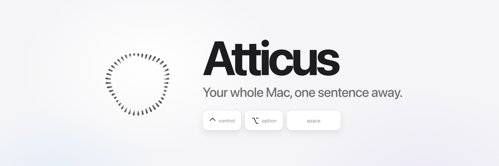

<p align="center"></p>

<p align="center">
  Hold <kbd>⌃ control</kbd> <kbd>⌥ option</kbd> <kbd>space</kbd>, say what you need, let go.<br>
  Atticus moves your windows, finds your files, reads your screen and gets it done.
</p>

<p align="center">
  
  
  
  
</p>

<br>

https://github.com/user-attachments/assets/e3444422-02e8-4dd7-bb44-d39f2b0f2bef

<br>

## Just ask

| You say | Atticus |
|---|---|
| *"Code on my big screen, Chrome and Terminal on the laptop."* | Arranges three windows across two displays. |
| *"Open Spotify."* · *"Terminal on the left."* | Runs instantly, with no AI at all. |
| *"Find my notes about the Tokyo trip."* | Searches your files by what's inside them, opens the match on your other screen. |
| *"What's wrong with this code?"* | Looks at your screen and answers in a line. |
| *"Summarize this article in three bullets."* | Reads the page for you. |
| *"Reply: sounds good, see you at 7."* | Types it into the app you're in. It never sends. |
| *"Play my late night coding playlist on Spotify."* | Plays it in a second, no clicks. Any song, artist or playlist. |
| *"When I say focus mode, close Slack and open my to-do list."* | Remembers it. Next time, two words do it all. |

<p align="center"></p>

## Why Atticus

<table>
<tr>
<td width="33%" valign="top"><h3>No API key</h3>Runs on the Claude plan you already have, through <code>claude -p</code>. Atticus is $5 once; AI usage uses your existing Claude plan.</td>
<td width="33%" valign="top"><h3>~700 asks for $1</h3>About 0.14¢ per ask in real use, priced at API list rates. Completed requests are logged with their cost in Settings → Usage.</td>
<td width="33%" valign="top"><h3>Instant when it can be</h3>Opening apps and sites, moving windows, web searches and music skip the AI entirely. With Start while I’m talking on, reasoning can start during pauses; AI tools wait for confirmed words.</td>
</tr>
<tr>
<td valign="top"><h3>Private ears</h3>Apple's on-device speech turns your voice into text. Audio never leaves your Mac.</td>
<td valign="top"><h3>Your whole Mac</h3>Apps, windows, files, settings, the web and the screen, with <a href="https://github.com/openclaw/Peekaboo">Peekaboo</a> for clicking inside any app.</td>
<td valign="top"><h3>Safe by default</h3>Safe mode runs the AI's commands in Claude Code's sandbox: they can only write to a scratch folder. Before anything deletes, sends, buys or changes a file, Atticus asks you first. <code>rm</code>, <code>sudo</code>, disk tools and shutdown are always blocked. Every exact command is in the ask log.</td>
</tr>
</table>

Choose **Hold to talk** or **Press to toggle** in Settings → General → Shortcut behavior. Hold mode sends when you release. Toggle mode starts on the first press and sends on the second; pauses keep listening. Pressing the shortcut while Atticus answers stops it; during spoken playback it stops the voice. Esc cancels listening without sending. Toggle recordings reach a review screen after 60 seconds, rather than sending automatically. Closing the overlay or pausing Atticus stops its microphone, workers and voice.

Click any answer to copy it, including earlier answers still shown in the box. Click your request to edit and ask again, or press ↑ in an empty typing box to recall the latest request. The overlay stays within your display when resized and respects Reduce Motion.

Apple's final transcript confirms each voice request before AI tools or learned shortcuts run. AI reasoning can start during a pause, but its tools wait for confirmation. If speech finalization takes too long, Atticus offers the partial text for review. Instant commands still skip the AI entirely. Supported built-in commands run mid-sentence, before you send, with Instant commands and Act while I’m talking on (Settings → Intelligence). Learned shortcuts wait for confirmed words.

## Install

You need:
- **macOS 26** or later (Atticus uses Apple's new on-device speech)
- **An [Atticus license](https://3370759087892.gumroad.com/l/atticus)** ($5 once). Open Atticus, hover the box to type `key <your key>` from your receipt.
- **A paid Claude plan** (Pro or Max) and [Claude Code](https://claude.com/claude-code). No Claude Code yet? The setup window installs it and signs you in.
- Apple's command line tools: `xcode-select --install`
- Optional: [Peekaboo](https://github.com/openclaw/Peekaboo) (see its install steps) so Atticus can click inside apps

Paste this in Terminal:

```
curl -fsSL https://raw.githubusercontent.com/SaarthurR/atticus-mac/main/install.sh | bash
```

It checks your Mac, downloads Atticus to `~/.atticus`, builds `~/Applications/Atticus.app`, and opens it. Atticus starts at login and updates itself from there (turn that off in Settings → About & Updates).

Working on the code instead? Clone the repo anywhere and run `./build.sh` after each change.

The first launch opens a setup window. It checks your Claude plan, then asks for each macOS permission.
After that, Atticus lives in the menu bar. Open it from Spotlight (⌘Space, "Atticus") for Settings: shortcut, sounds, model, speed, screen, memory and usage.
If you sign out of Claude later, the setup window comes back by itself.
To see it again: `defaults delete com.atticus.app onboarded`, then restart the app.

Test: `python3 atticus.py --selftest` on macOS, plus `python3 -m unittest discover -s tests -v` for offline regressions. After building, `~/Applications/Atticus.app/Contents/MacOS/Atticus --selftest` checks native transcript matching without opening the app. Node, when installed, also checks embedded JavaScript syntax. For the UI interaction checks, run `python3 -m http.server 8765 --bind 127.0.0.1` from the repo and open `http://127.0.0.1:8765/tests/ui.html`; it uses a mock native bridge and makes no Mac actions or AI calls.

Remove: `launchctl bootout gui/$(id -u)/com.atticus.app`, then delete `~/Applications/Atticus.app`, `~/.atticus`, `~/.config/atticus` (your settings and history) and `~/Library/LaunchAgents/com.atticus.app.plist`.

## Watch for me

Say "tell me when Codex is done" or "watch this page until it says shipped". Atticus sets it up once, then checks every 5 seconds on your Mac with no AI, so waiting is free. When it fires you get a notification, and it runs a follow-up if you asked for one. A window must stay open on this desktop (covered is fine). Coding agents like Codex are watched through their own log, with no screen at all. Say "stop watching" to cancel.

## Budget

Atticus has to stay fast and nearly free, so new features must fit under these limits:

- Instant commands: no AI, $0.
- AI asks: median under $0.002 and 6 s over the last 50 (Oct 10, 2026: $0.00095, 5.0 s). Check with `python3 atticus.py --budget`.
- System prompt: under 10,000 characters with every option on. Every ask pays for it, and a test enforces it.
- Anything that waits or runs in the background: $0 while it waits. AI only to set it up and to act at the end.

## Usage count

Once a day, Atticus sends one random ID (made on your Mac, not tied to you) to PostHog, so I can see how many people use it. It never sends your name, your asks or your screen. Turn it off in Settings → Account & Access → Count me as a user.

## Files

- `Atticus.swift`: the app (hotkey, speech, overlay, onboarding window)
- `atticus.py`: the brain (fast commands, system prompt, helpers for windows, web and screen)
- `ui/ui.html`, `ui/onboarding.html`, `ui/settings.html`: the overlay, the welcome flow, and Settings
- `ui/AppIcon.icns`: the app icon
- `ui/orbs.js`: the [thinking-orbs](https://github.com/Jakubantalik/thinking-orbs) engine (MIT, Jakub Antalik)

## License

MIT. See `LICENSE`. `ui/orbs.js` is from [thinking-orbs](https://github.com/Jakubantalik/thinking-orbs), also MIT.

## Contributing

UI contributors: read [the Atticus design skill](.agents/skills/atticus-design/SKILL.md). Codex uses the repository's `AGENTS.md`, Claude Code uses `CLAUDE.md` and its local skill link, and Cursor uses `.cursor/rules/atticus-design.mdc`. These instructions apply only to this project.

Run regressions with a scratch `ATTICUS_DIR` and use `tests/ui.html` and `tests/settings.html` for mock-bridge UI checks. Keep personal agent settings, credentials and runtime state out of commits. Anonymous usage telemetry is disabled unless `ATTICUS_POSTHOG_KEY` is supplied through the environment; no key is embedded in the source.
