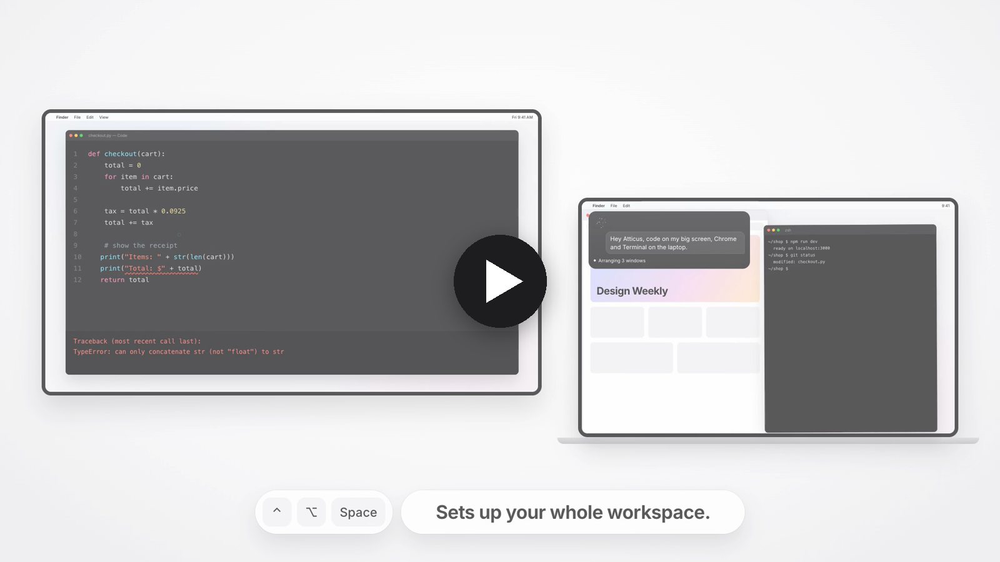

<p align="center"></p>

<p align="center">
  Hold <kbd>⌃ control</kbd> <kbd>⌥ option</kbd> <kbd>space</kbd>, say what you need, let go.<br>
  Atticus moves your windows, finds your files, reads your screen and gets it done.
</p>

<p align="center">
  
  
  
  
</p>

<br>

<p align="center">
  <a href="docs/atticus-film.mp4"></a><br>
  <sub><b>▶ Watch the film</b> · 75 seconds</sub>
</p>

<br>

## Just ask

| You say | Atticus |
|---|---|
| *"Code on my big screen, Chrome and Terminal on the laptop."* | Arranges three windows across two displays. |
| *"Open Spotify."* · *"Terminal on the left."* | Runs instantly, with no AI at all. |
| *"Find my notes about the Tokyo trip."* | Searches your files by what's inside them, opens the match on your other screen. |
| *"What's wrong with this code?"* | Looks at your screen and answers in a line. |
| *"Summarize this article in three bullets."* | Reads the page for you. |
| *"Reply: sounds good, see you at 7."* | Types it into the app you're in. It never sends. |
| *"Play my late night coding playlist on Spotify."* | Plays it in a second, no clicks. Any song, artist or playlist. |
| *"When I say focus mode, close Slack and open my to-do list."* | Remembers it. Next time, two words do it all. |

<p align="center"></p>

## Why Atticus

<table>
<tr>
<td width="33%" valign="top"><h3>No API key</h3>Runs on the Claude plan you already have, through <code>claude -p</code>. Nothing new to pay for.</td>
<td width="33%" valign="top"><h3>~700 asks for $1</h3>About 0.14¢ per ask in real use, priced at API list rates. Every ask is logged with its cost in the menu bar.</td>
<td width="33%" valign="top"><h3>Instant when it can be</h3>Opening apps and sites, moving windows, web searches and music skip the AI entirely. Everything else starts while you are still talking.</td>
</tr>
<tr>
<td valign="top"><h3>Private ears</h3>Apple's on-device speech turns your voice into text. Audio never leaves your Mac.</td>
<td valign="top"><h3>Your whole Mac</h3>Apps, windows, files, settings, the web and the screen, with <a href="https://github.com/openclaw/Peekaboo">Peekaboo</a> for clicking inside any app.</td>
<td valign="top"><h3>Safe by default</h3>Deleting, <code>sudo</code>, disk tools, shutdown and <code>git push</code> are blocked, so a misheard word can't do damage.</td>
</tr>
</table>

Esc stops an answer. Pressing the keys again cancels it.

## Install

You need:
- **macOS 26** or later (Atticus uses Apple's new on-device speech)
- **A paid Claude plan** (Pro or Max) and [Claude Code](https://claude.com/claude-code). No Claude Code yet? The setup window installs it and signs you in.
- Apple's command line tools: `xcode-select --install`
- Optional: [Peekaboo](https://github.com/openclaw/Peekaboo) (see its install steps) so Atticus can click inside apps

```
git clone https://github.com/SaarthurR/atticus-mac.git
cd atticus-mac
./build.sh
```

`build.sh` builds `~/Applications/Atticus.app`, starts it now and at every login. Run it again after any change.

The first launch opens a setup window. It checks your Claude plan, then asks for each macOS permission.
If you sign out of Claude later, the setup window comes back by itself.
To see it again: `defaults delete com.atticus.app onboarded`, then restart the app.

Test: `python3 atticus.py --selftest`. Remove: `launchctl bootout gui/$(id -u)/com.atticus.app`, then delete `~/Applications/Atticus.app` and `~/Library/LaunchAgents/com.atticus.app.plist`.

## Files

- `Atticus.swift`: the app (hotkey, speech, overlay, onboarding window)
- `atticus.py`: the brain (fast commands, system prompt, helpers for windows, web and screen)
- `ui/ui.html`, `ui/onboarding.html`: the overlay and the welcome flow
- `ui/orbs.js`: the [thinking-orbs](https://github.com/Jakubantalik/thinking-orbs) engine (MIT, Jakub Antalik)
